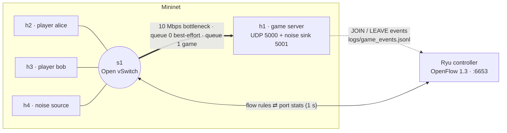
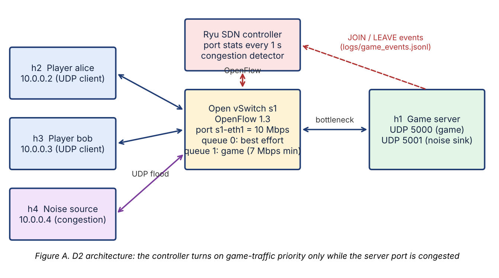
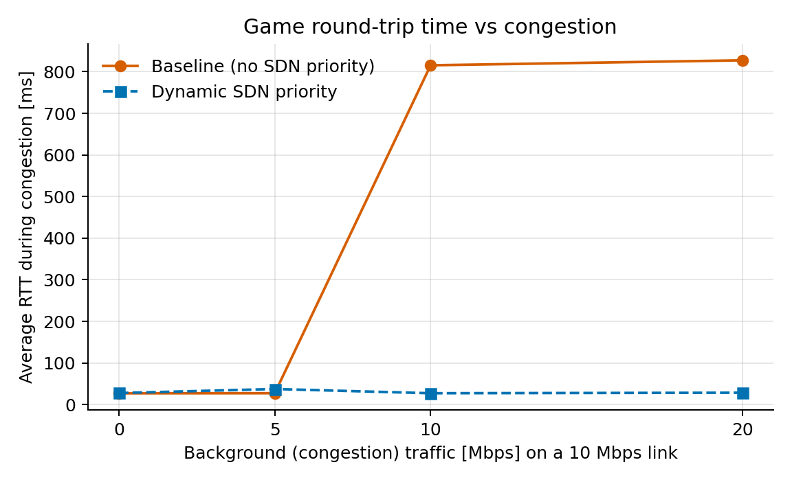
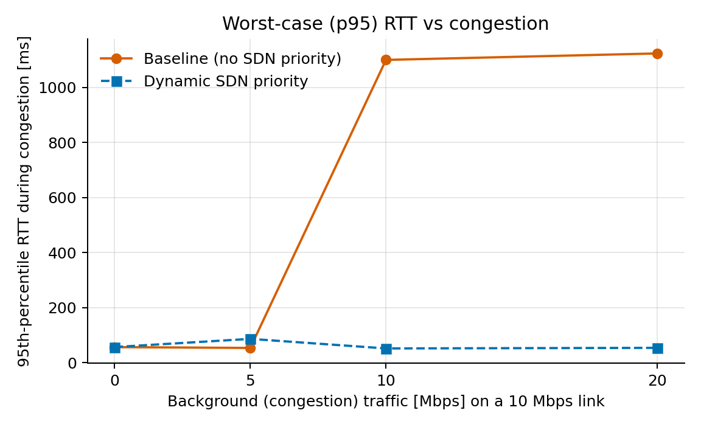
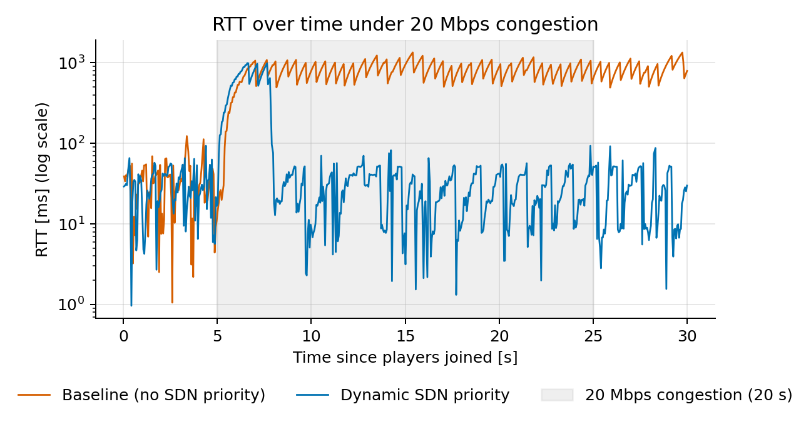
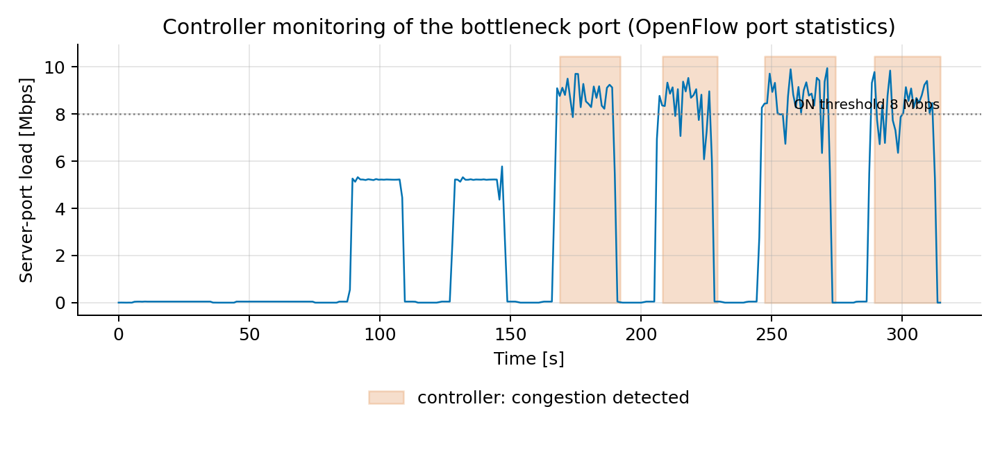

<div align="center">

# 🎮 Multiplayer Game Communication Network
### UDP game traffic + SDN priority queuing (Mininet · Open vSwitch · Ryu)


*Computer Networks mini-project, "SDN – Socket Programming", Project 17*

</div>

---

## TL;DR
Real-time games send small state updates many times per second. When a link gets congested, those updates queue behind bulk
traffic and the game lags. This project builds a small game network, **shows the problem**, and **fixes it with an SDN controller**
that gives game packets a priority queue **only while the link is congested**.

> At 20 Mbps of background traffic the average game RTT drops from **~676 ms to ~85 ms** (≈8×); at 10 Mbps from **~572 ms to ~39 ms** (≈14×).
> With no congestion the two modes behave identically (~29 ms), so the controller costs nothing when the network is quiet.

## Team 4
| SRN | Name | Contribution |
|---|---|---|
| PES2UG25CS143 | **D Arpitha** | UDP socket programming and game communication: server and player client, JOIN/WELCOME registration, STATE/WORLD messages, sequence numbers, loss and duplicate detection |
| PES2UG25CS152 | **Deeksha M Reddy** | SDN architecture and network configuration: Mininet topology, Open vSwitch, Ryu controller, UDP-port-5000 traffic classification, QoS queues and priority rules |
| PES2UG25CS180 | **G M Hrithick** | Integration, measurement and testing: UDP↔SDN integration, latency / RTT / jitter measurement, connectivity and loss testing, server-statistics analysis, results |

### Requirements covered
| Project requirement | Where |
|---|---|
| UDP game-state updates | `game_client.py` → `game_server.py` (STATE / WORLD) |
| Register multiple players | JOIN → WELCOME handshake with retries, per-player state on the server |
| Sequence numbers | Every STATE carries `seq`; server detects gaps, duplicates and reordering |
| Handle packet loss | No retransmission by design: the next update supersedes the lost one; loss is counted |
| Traffic prioritisation | `controller.py`: OpenFlow flow rules → `set_queue(1)` on an OVS HTB queue |
| Measure latency and jitter | One-way delay and RFC 3550 jitter (server), RTT by timestamp echo (client) |
| Test under congestion | `noise.py` floods the bottleneck at 5 / 10 / 20 Mbps; `experiment.py` compares modes |
| Dynamic SDN behaviour | Rules are installed on `CONGESTION_ON` and removed on `CONGESTION_OFF` |

## Architecture




**How it works**
1. Players register with the server and stream numbered `STATE` packets; the server broadcasts `WORLD` snapshots at 20 Hz and echoes each player's timestamp so the client can compute RTT.
2. The controller polls the byte counter of the server-facing port every second and converts it to Mbps.
3. A **hysteresis detector** declares congestion after 2 consecutive samples ≥ 8 Mbps and clears it after 3 consecutive samples < 4 Mbps.
4. On `CONGESTION_ON` it installs priority-10 flows (UDP port 5000, both directions, per joined player) that send game packets to **queue 1**, which HTB guarantees ≥ 7 Mbps of the 10 Mbps link. On `CONGESTION_OFF` the flows are removed.

```
CONGESTION_ON  {'mbps': 9.99}
QOS_INSTALLED  {'ip': '10.0.0.3', 'mode': 'dynamic', 'queue': 1}
QOS_INSTALLED  {'ip': '10.0.0.2', 'mode': 'dynamic', 'queue': 1}
...
QOS_REMOVED    {'ip': '10.0.0.3', 'mode': 'dynamic'}
CONGESTION_OFF {'mbps': 0.0}
```

### Policy modes (`logs/qos_mode`, changed live with `echo <mode> > logs/qos_mode`)
| Mode | Behaviour |
|---|---|
| `off` | Baseline: no prioritisation |
| `static` | Priority rules for every joined player, always on |
| `dynamic` | Priority rules only while congestion is detected *(the project's contribution)* |

## Results
Two players, 30 s per run, background UDP flood from h4 for 20 s. Values are the mean of the two players (`results/summary.csv`).

| Background load | Mode | Avg RTT (ms) | p95 RTT (ms) | Jitter (ms) | Lost / stale (%) |
|---:|---|---:|---:|---:|---:|
| 0 Mbps | off | 28.2 | 56.0 | 8.7 | 0.0 |
| 0 Mbps | dynamic | 29.0 | 58.0 | 17.1 | 0.0 |
| 5 Mbps | off | 29.2 | 55.8 | 26.5 | 0.0 |
| 5 Mbps | dynamic | 32.9 | 66.3 | 14.8 | 0.0 |
| 10 Mbps | off | 571.5 | 1052.7 | 32.3 | 0.0 |
| 10 Mbps | **dynamic** | **39.4** | **110.6** | 14.3 | 1.3 |
| 20 Mbps | off | 676.3 | 1099.7 | 95.4 | 0.7 |
| 20 Mbps | **dynamic** | **84.9** | **630.9** | 7.4 | 2.1 |

**Congestion detection delay:** 2.84 s at 10 Mbps, 3.03 s at 20 Mbps; **not triggered at 5 Mbps** (below the 8 Mbps threshold, so nothing is installed).

<p align="center">
  
  
</p>
<p align="center">
  
  
</p>

**Reading the results**
- **No congestion (0 and 5 Mbps):** both modes are equal, so dynamic priority does not hurt a quiet network.
- **Congestion (10 and 20 Mbps):** without priority the game packets sit behind the flood (**bufferbloat**: huge delay, almost no loss). With dynamic priority RTT stays in the tens of ms.
- **The p95 at 20 Mbps is still ~630 ms** because of the ~3 s detection window: until the controller reacts, game packets still queue behind the flood. This is the cost of reacting dynamically instead of always prioritising.
- **"Lost / stale" is slightly higher in dynamic mode.** When the flows move to queue 1, a few packets are reordered; the server discards the older sequence numbers. In the baseline those packets arrive, only very late.
- RTT on an idle link is ~27 ms, not ~1 ms, because the echoed timestamp is returned in the next 20 Hz `WORLD` broadcast (up to 50 ms server tick). One-way delay measured at the server is ~0.5 ms.

## Repository layout
```
.
├── game_server.py     UDP game server (h1, UDP 5000)
├── game_client.py     UDP player (automatic mode, or -i interactive)
├── noise.py           UDP traffic generator / sink that creates congestion
├── controller.py      Ryu controller: learning switch, congestion detector, QoS rules
├── topo.py            Mininet topology + OVS HTB queues
├── experiment.py      Automated baseline-vs-dynamic experiment
├── plot_results.py    Graphs from results/
├── make_report.py     Optional: builds a Word report from results/
├── tests/             Offline unit tests (no root / Mininet needed)
├── docs/              Architecture diagram, protocol description
├── results/           summary.csv, graphs, controller events, queue counters
└── logs/              Runtime logs (git-ignored)
```
More detail on the message formats is in [`docs/PROTOCOL.md`](docs/PROTOCOL.md).

## Quick start
**Requirements:** Ubuntu with Mininet and Open vSwitch, and Ryu in a Python 3.9 environment (Ryu does not build on Python ≥ 3.12).
```bash
sudo apt install mininet openvswitch-switch python3-matplotlib python3-docx -y
uv python install 3.9 && uv venv --python 3.9 ~/ryuenv && source ~/ryuenv/bin/activate
uv pip install "setuptools<58" wheel pbr
uv pip install --no-build-isolation ryu eventlet==0.30.2
```

**Terminal 1: controller** (start this first, and never run `sudo mn -c` while it is running)
```bash
sudo mn -c && sudo rm -f logs/*
source ~/ryuenv/bin/activate
ryu-manager controller.py
```
**Terminal 2: network**
```bash
sudo python3 topo.py
```
At the `mininet>` prompt (baseline, then dynamic):
```text
sh echo off > logs/qos_mode
h2 python3 game_client.py --name alice --server 10.0.0.1 --duration 45 > logs/a1.out 2>&1 &
h3 python3 game_client.py --name bob   --server 10.0.0.1 --duration 45 > logs/b1.out 2>&1 &
sh sleep 8
h4 python3 noise.py --target 10.0.0.1 --mbps 20 --duration 20 > logs/n1.out 2>&1 &
sh sleep 10
sh tail -n 2 logs/a1.out                     # RTT in the hundreds of ms

sh echo dynamic > logs/qos_mode              # (wait for the first run to finish)
h2 python3 game_client.py --name alice --server 10.0.0.1 --duration 45 > logs/a2.out 2>&1 &
h3 python3 game_client.py --name bob   --server 10.0.0.1 --duration 45 > logs/b2.out 2>&1 &
sh sleep 8
h4 python3 noise.py --target 10.0.0.1 --mbps 20 --duration 20 > logs/n2.out 2>&1 &
sh sleep 10
sh tail -n 2 logs/a2.out                     # RTT stays low; Terminal 1 shows QOS_INSTALLED
sh tc -s class show dev s1-eth1              # per-queue counters (class 1:2 = game queue)
```
**Terminal 3 (optional): live server view**
```bash
tail -f logs/server.log
```

### Interactive game mode
```bash
h2 python3 game_client.py -i --name alice --server 10.0.0.1     # prompts for Player ID, x and y
```

### Reproduce the full experiment
Stop `topo.py` first (the controller keeps running):
```bash
sudo python3 experiment.py            # ≈ 10 min (use --quick for ≈ 5 min)
python3 plot_results.py               # graphs → results/graphs/, detection_time.csv
python3 make_report.py                # optional Word report
```

### Unit tests (no root needed)
```bash
python3 -m unittest discover -s tests -v
```
They check the congestion detector (hysteresis, spike rejection) and the server's registration, loss, duplicate, reordering and jitter logic.

## Test cases
| # | Test | Expected |
|---|---|---|
| 1 | Connectivity (`pingall`) | 0 % dropped |
| 2 | Two players join | Server logs both; controller logs `PLAYER_JOIN` |
| 3 | No congestion (0 / 5 Mbps) | Low RTT in both modes; no rules installed |
| 4 | 10 / 20 Mbps, mode `off` | RTT and jitter rise sharply |
| 5 | 10 / 20 Mbps, mode `dynamic` | `CONGESTION_ON` → `QOS_INSTALLED`; RTT stays low after a short transient |
| 6 | Congestion ends | `CONGESTION_OFF` → `QOS_REMOVED` |
| 7 | Out-of-order / duplicate / gap packets | Counted separately (unit tests) |

## Limitations and future work
- Emulation only: one switch, one server, one bottleneck link.
- Congestion is detected from **link utilisation** polled once per second, so reaction takes ~3 s; delay-based detection and faster polling would shorten this.
- The server tells the controller about players through a **shared file** (`logs/game_events.jsonl`) rather than a direct socket/REST channel.
- Only UDP port 5000 is classified; other traffic uses the default queue.
- Possible extensions: multiple servers/switches, per-player fairness, REST API between server and controller, live dashboard.

## License
MIT, see [`LICENSE`](LICENSE).
